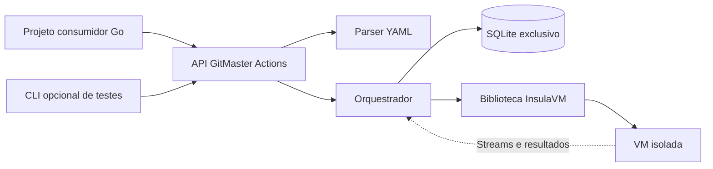

<!-- A-BIOMA-DOC-STANDARD -->
<!-- A-BIOMA-DOC-REVISADO -->

# ARQ-001 — Arquitetura da biblioteca GitMaster Actions

**Estado:** biblioteca de execução/consulta e runtime InsulaVM implementados em Go, ainda sem validação local de compilação ou KVM. As extensões não implementadas continuam explicitamente propostas.

## Objetivo

Fornecer um **pacote Go importável** por outros projetos. Não executar como serviço nem daemon. A CLI opcional é um programa auxiliar de testes locais que chama a mesma biblioteca e não contém regras de orquestração ou SQL próprias. O projeto consumidor fornece YAML em memória ou caminho local; a biblioteca gerencia o SQLite, os UUIDs, o ciclo de Action e a VM por meio da API Go do InsulaVM.

## Componentes

| Componente | Responsabilidade |
| --- | --- |
| Projeto consumidor | Chamar a biblioteca, fornecer YAML ou caminho, controlar contexto |
| CLI auxiliar (`cmd/gitmaster-actions`) | Traduzir argumentos, arquivos/stdin e formatos de saída para chamadas da API pública, sem lógica de execução ou SQL |
| API Go GitMaster Actions | Execução e navegação `Action.Jobs → Job.Commands → Command.Logs/Outputs`, sem SQL exposto |
| Parser/validador | Ler e validar manifesto, origem da VM e caminhos |
| Orquestrador | Gerar UUIDs, registrar estados, executar jobs e comandos |
| Repositório SQLite interno | Criar esquema, migrar e persistir Action, Jobs, Comandos, chunks e linhas indexadas |
| Adaptador InsulaVM | Iniciar/encerrar VM, transferir arquivos, executar comandos e registrar perfil por métodos públicos; sem duplicar catálogo de perfis |
| InsulaVM | Gerenciar QEMU/KVM/Libvirt, Cloud-Init e SSH |

## Invariantes

1. Cada Action, Job e Comando tem UUIDv7 próprio; o VMID é atribuído pelo InsulaVM e utilizado em memória, sem persistência na Action.
2. Uma VM local clonada de perfil existente por Action. Jobs são filhos diretos da Action (não há pipelines); jobs e comandos executam em sequência, com nova sessão remota por comando.
3. `actions.db` pertence ao GitMaster Actions; `insula.db` pertence ao InsulaVM. Não escrever diretamente no banco do InsulaVM.
4. A biblioteca é a única responsável por gravações e migrações de `actions.db`; consumidores, inclusive a CLI, usam métodos de leitura e execução. Consultas não dependem da inicialização de VM.
5. O YAML não pode escolher o caminho do banco nem o arquivo global InsulaVM; são opções administrativas de `New`.
6. O manifesto exige perfil QCOW2 já preparado no InsulaVM do mesmo host. O perfil define memória e CPUs; sobrescritas opcionais valem apenas para a instância.
7. O adaptador atual reconhece os prefixos textuais de stdout/stderr emitidos pelo InsulaVM; **não** fornece fidelidade binária nem streams nativos. A futura API de streams estruturados continua pendente.
8. Comandos do YAML não executam no host; a biblioteca delega a execução ao InsulaVM. Scripts administrativos de bootstrap não são aceitos do YAML não confiável.
9. Cancelamento e erros não devem descartar logs parciais; encerrar a VM com contexto de cleanup independente.
10. Logs incrementais usam cursor de linha persistido, preservando separadamente os chunks binários originais.
11. `CreateProfile` é operação administrativa separada de `RunFile`/`RunYAML`: perfis residem no InsulaVM; rede por perfil e clonagem não destrutiva de VM existente estão pendentes e não podem ser simuladas silenciosamente.
12. O GitMaster Actions ainda não recupera VMs após queda/reinício. Seu SQLite conserva somente estados e logs, e não armazena ID nem configuração da VM; status `running` após falha pode ser residual.
13. A biblioteca não implementa protocolo GitHub Actions runner nem serviço de rede. A CLI só cria processos de curta duração para testes; não inicializa listener ou processo residente.

## Documentos canônicos

- [INTF-GO-001 — API pública](../interfaces/go/INTF-GO-001-biblioteca-publica.md)
- [INTF-TERM-001 — CLI auxiliar](../interfaces/terminal/INTF-TERM-001-cli-testes.md)
- [CONTR-001 — YAML](../contratos/CONTR-001-configuracao-action.md)
- [CONTR-002 — Criar perfil](../contratos/CONTR-002-criacao-perfil.md)
- [PERS-001 — Banco SQLite](../persistencia/PERS-001-registro-execucoes.md)
- [FLUX-001 — Processamento](../fluxos/FLUX-001-execucao-action.md)
- [API Go do InsulaVM](https://github.com/ahhvahh/InsulaVM/blob/main/docs/arquitetura/ARQ-004-biblioteca-go.md)