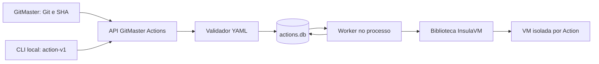

<!-- A-BIOMA-DOC-STANDARD -->
<!-- A-BIOMA-DOC-REVISADO -->

# ARQ-001 — Executor de Actions

**Estado:** executor Go implementado com armazenamento SQLite exclusivo; a execução em KVM/Libvirt real ainda depende de teste autorizado. O suporte nativo a streams binários separados não é disponibilizado por `ExecVM` na versão fixada do InsulaVM.

## Contexto e componentes

- **GitMaster:** é o responsável pelo Git, pela escolha do YAML na árvore imutável, pelo TAR.GZ e pelo evento; não há Git, clone, commit ou push no GitMaster Actions.
- **GitMaster Actions:** valida, cadastra Action/Jobs/Commands, organiza dependências, mantém o `actions.db`, executa workers, coleta saídas e controla VM/cleanup.
- **InsulaVM:** implementa `StartVMWithOptions`, `DeployToVM`, `ExecVM`, `StopVM`, perfis, QEMU/Libvirt, Cloud-Init e transporte SSH. Nenhum step do YAML é executado no host.
- **CLI:** adaptador opcional da mesma biblioteca; `RunFile` e `RunYAML` aguardam o executor assíncrono em vez de reimplementá-lo.

## Invariantes operacionais

1. `SubmitYAML` aceita somente `action-v1` ou `gitmaster-workflow-v1` selecionado explicitamente. Valida todo o manifesto antes de criar VM.
2. A transação grava Action UUIDv7, Jobs e Commands completos **antes** de iniciar worker. `pending` não significa sucesso.
3. Uma chamada `StartVMWithOptions` cria uma VM isolada para a Action. O VM ID fica persistido em `actions.vm_id`, junto do estado de cleanup.
4. Jobs respeitam `needs`; comandos executam sequencialmente na mesma VM. O consumidor não compartilha comandos shell entre Actions.
5. A origem Git, o hash SHA256 do YAML e o hash SHA256 do snapshot são persistidos. Replay da mesma identidade com conteúdo diferente retorna conflito.
6. `actions.db` é independente; `New` toma um lock exclusivo em `<actions.db>.lock` enquanto o Engine estiver aberto. Processos concorrentes devem usar a mesma instância de Engine.
7. Falhas e cancelamentos mantêm resultados, logs e eventos; `StopVM` usa contexto de cleanup independente. `Close` recusa encerrar um Engine com Actions em execução.
8. Na reabertura, Actions não terminais anteriores são marcadas `failed`; a recuperação não retoma comandos. `ReconcileInterrupted` tenta parar **somente** VMs registradas para Actions terminais com cleanup pendente.
9. O snapshot é TAR.GZ validado, copiado para local privado antes do enfileiramento e apagado ao terminar. As restrições são verificadas em [CONTR-003](../contratos/CONTR-003-gitmaster-workflow.md).

## Limites e compatibilidade

- A biblioteca mantém o pacote `legacy` apenas como interface de compatibilidade. **Esse pacote ainda recebe `*sql.DB` do consumidor antigo**; novas integrações devem usar `New(Options)` e `SubmitYAML`.
- `ImportLegacyHistory` copia os dados em modo somente leitura e normaliza o grafo em `actions.db` com IDs de mapeamento, mantendo as linhas originais em `legacy_archive`.
- Logs `stdout`/`stderr` são inferidos dos prefixos textuais gerados por `ExecVM`. Não há garantia de bytes nativos nem suporte a captura remota de stdin.
- Se o processo terminar depois de criar uma VM, mas antes de registrar `vm_id`, a biblioteca não consegue identificá-la para cleanup automático. O InsulaVM permanece responsável por seu próprio tratamento de falhas de startup.

## Referências

[API](../interfaces/go/INTF-GO-001-biblioteca-publica.md) · [Fluxo](../fluxos/FLUX-001-execucao-action.md) · [Persistência](../persistencia/PERS-001-registro-execucoes.md) · [Separação de projetos](ARQ-002-separacao-gitmaster.md)
## Organização do código

A implementação continua em uma biblioteca Go modular, agora em [`/src`](../../src/). A raiz expõe a API pública de compatibilidade em [`api.go`](../../api.go); a fachada [`legacy/api.go`](../../legacy/api.go) mantém o caminho importado pelo GitMaster enquanto a implementação antiga reside em `src/legacy/`. Os contratos e fluxos permanecem em `/docs`. Os binários CLI são compilados a partir de `src/cmd/`, com destino informado a [`scripts/build.sh`](../../scripts/build.sh). Veja [GUIA-010](../guias/GUIA-010-build-testes.md).
