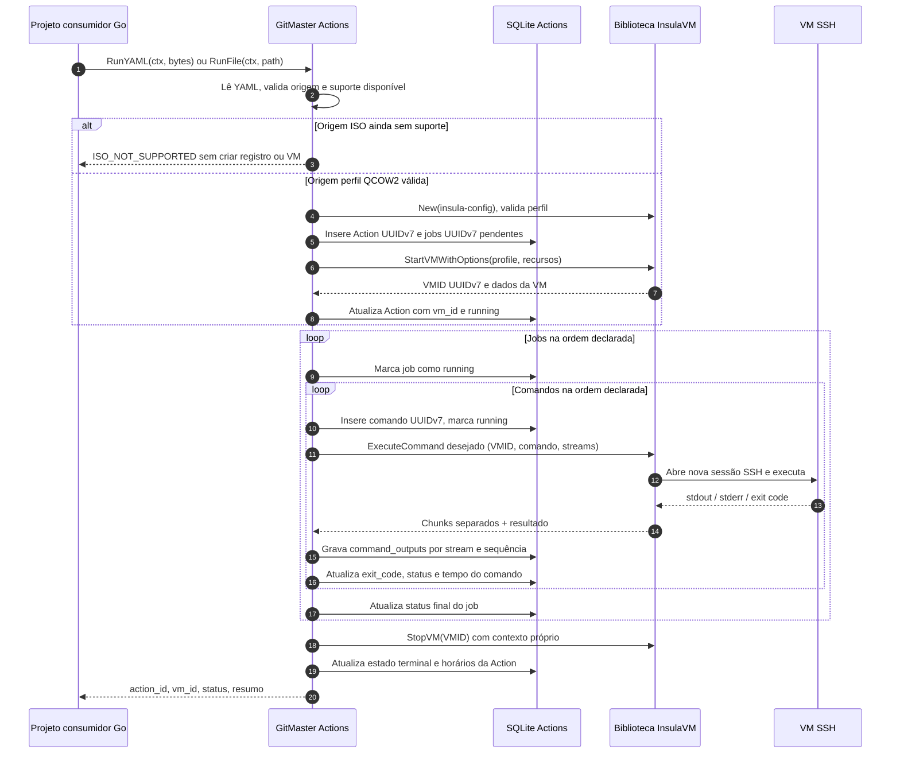

<!-- A-BIOMA-DOC-STANDARD -->
<!-- A-BIOMA-DOC-REVISADO -->

# FLUX-001 — Executar uma Action em VM isolada

**Estado:** proposto; nenhuma implementação neste repositório.
**Versão aprovada:** nenhuma.

## Objetivo

Receber YAML em memória ou o caminho do manifesto, registrar a execução com UUID, iniciar uma VM pelo InsulaVM e executar os comandos dos jobs, gravando os eventos de I/O no SQLite com vínculos rastreáveis.

## Entrada e pré-condições

- YAML válido (bytes ou arquivo local) segundo [CONTR-001](../contratos/CONTR-001-configuracao-action.md).
- Opções administrativas `InsulaConfigPath` e `DatabasePath` fornecidas ao inicializar `Engine`.
- Perfil QCOW2 instalado e reconhecido no InsulaVM, ou ISO em **modo futuro ainda não suportado**.
- InsulaVM configurado e autorizado a operar Libvirt, Cloud-Init e SSH; espaço no disco para banco e imagens.
- Para separar `stdin/stdout/stderr` e capturar exit code fielmente, a implementação depende do contrato `ExecuteCommand` futuro do InsulaVM; `ExecVM` atual não supre esses campos.

## Diagrama de sequência

O diagrama exibe a **meta futura**, não chamadas que já estejam todas disponíveis na biblioteca. `ExecuteCommand` e provisionamento por ISO permanecem dependências externas.

## Processamento proposto

1. Validar a entrada de `RunYAML` ou `RunFile`, manifesto YAML, origem perfil/ISO e caminhos administrativos; rejeitar comandos inválidos antes de iniciar VM.
2. Gerar `action_id` UUIDv7, calcular SHA-256 do manifesto e criar o cabeçalho da Action. Criar uma linha UUIDv7 para cada job na ordem definida. Persistir esses registros em transação.
3. Inicializar a biblioteca com `insulavm.New` e validar origem. No modo perfil, criar a VM isolada e guardar `vm_id` gerado pelo InsulaVM; no modo ISO ainda não suportado, retornar erro controlado.
4. Executar importações opcionais **somente por operações públicas do InsulaVM**, respeitando `guest.destination` e validação dos arquivos.
5. Para cada job, processar os comandos em sequência. Antes de enviar comando, gerar `command_id` UUIDv7 e persistir seu texto. Cada comando é uma execução independente; não preservar estado de shell entre comandos.
6. Receber os bytes de stdin (quando houver e se captura autorizada), stdout e stderr com escritores independentes; persistir como chunks BLOB em `command_outputs` antes de marcar comando como finalizado.
7. Registrar exit code remoto verdadeiro. Se não zero, marcar comando com falha e interromper os comandos seguintes e jobs posteriores quando `allow_failure=false`; com `allow_failure=true`, continuar desde que seja falha remota conhecida, não erro de infraestrutura.
8. Em cancelamento, falha de execução ou falha de armazenamento, registrar o que for possível, não declarar sucesso e tentar encerrar a VM. Marcar jobs/comandos que não começaram como `skipped` ou `cancelled`, conforme causa.
9. Sempre tentar `StopVM` explicitamente, usando contexto de limpeza independente do contexto cancelado. Registrar erro de limpeza na Action e **não** marcar sucesso completo se a política de limpeza obrigatória falhar.
10. Atualizar status terminal e `finished_at`, emitir `action_id`, `vm_id` e status ao chamador. Preservar o banco independentemente de a VM ter sido removida.

## Exceções e resultados

| Situação | Tratamento proposto |
| --- | --- |
| Configuração inválida | Rejeitar antes de provisionar; não inventar execução concluída |
| Perfil inexistente | Falha de validação sem criar VM |
| ISO fornecida | `ISO_NOT_SUPPORTED` até `CreateProfileFromISO` existir |
| Libvirt/Cloud-Init/SSH falha | Marcar Action `failed`, manter log parcial, tentar cleanup |
| Código remoto não zero | Persistir exit code e `remote_exit`; respeitar `allow_failure` |
| Cancelamento | Parar envio, preservar logs capturados, tentar `StopVM`, registrar `cancelled` se confirmado |
| Falha ao gravar SQLite | Não declarar sucesso; priorizar parada segura e emitir erro ao operador |
| Cleanup da VM falha | Retornar erro e preservar `vm_id` para diagnóstico e limpeza manual |

## Critérios de aceite futuros

- Nenhum comando é executado antes de o job, o comando e a Action terem seus respectivos IDs registrados.
- Logs de uma Action não se misturam aos de outra; VMID nunca é usado como substituto de `action_id`.
- A execução de comandos é sequencial por job, na ordem do manifesto.
- As saídas stdout/stderr são preservadas em bytes por canal, sem conversões, e exit code é distinto de erro de transporte.
- Falhas parciais e cancelamentos nunca são reportados como sucesso.
- A política de limpeza não remove VMs de outras Actions.

## Referências

- [CONTR-001 — Entrada](../contratos/CONTR-001-configuracao-action.md)
- [PERS-001 — Persistência](../persistencia/PERS-001-registro-execucoes.md)
- [ARQ-001 — Arquitetura](../arquitetura/ARQ-001-executor-actions.md)
- [InsulaVM: API Go existente](https://github.com/ahhvahh/InsulaVM/blob/main/docs/arquitetura/ARQ-004-biblioteca-go.md)

## Consultas após a execução

O consumidor usa `GetAction`, `ListActions`, `ListJobs`, `ListCommands` e `ListCommandOutputs` para consultar o histórico; nenhuma consulta altera os dados. Ver [INTF-GO-001](../interfaces/go/INTF-GO-001-biblioteca-publica.md). A [CLI local de testes](../interfaces/terminal/INTF-TERM-001-cli-testes.md) utiliza essas mesmas operações, portanto não constitui um fluxo de execução diferente.