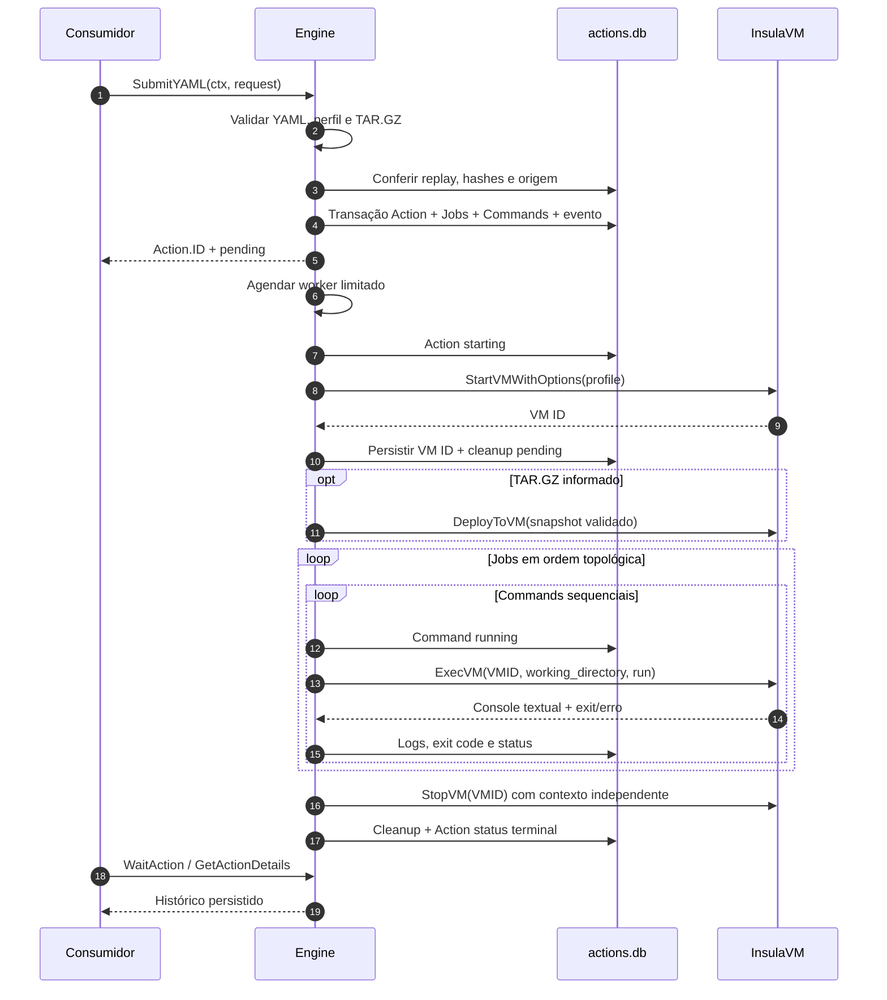

<!-- A-BIOMA-DOC-STANDARD -->
<!-- A-BIOMA-DOC-REVISADO -->

# FLUX-001 — Executar uma Action na VM isolada

**Estado:** implementado em `SubmitYAML`/`runSubmittedAction` com testes simulados. O teste real em KVM/Libvirt não foi realizado.

## Entradas

- `SubmitRequest`: YAML `[]byte`, formato explícito, origem opcional e TAR.GZ autorizado opcional.
- `Options`: caminhos administrativos de `actions.db`, configuração InsulaVM, workers, scripts de bootstrap confiáveis e imagens.
- `RunFile(ctx, path)` e `RunYAML(ctx, []byte)` são wrappers **síncronos** para o formato `action-v1`; submetem à mesma rotina e aguardam o estado terminal.

## Sequência real

## Falhas e estados

- Rejeitar YAML/formato/perfil/arquivo inválido **antes de criar VM**. Se a solicitação for aceita, os IDs dos Jobs e Commands já existem no banco.
- Exit code remoto não zero gera comando `failed`; `allow_failure` tolera **somente** a falha remota conhecida. Dependentes de Jobs com falha são `skipped`.
- Transporte, timeout, armazenamento e falha de bootstrap resultam em Action `failed`; registros pendentes/em execução são encerrados com status terminal. Cancelamento explícito retorna `cancelled`, exceto quando o cleanup falha, caso em que a Action registra `failed`.
- O callback do console utiliza contexto de escrita independente para persistir logs recebidos durante cancelamento. O console é texto decorado, não byte stream nativo.
- Cleanup falho registra `cleanup_status=failed` e `cleanup_error`; o operador pode chamar `ReconcileInterrupted` posteriormente. Falhas de persistência nunca são declaradas como sucesso.
- Reinício reconhece Actions interrompidas e conserva histórico; **não retoma steps**, nem executa automaticamente comandos pendentes.

## Consultas e interfaces

`GetActionDetails` recupera cabeçalho, origem, Jobs, Commands, VM, cleanup e eventos; `ListCommandLogs` e `ListCommandOutputs` paginam linhas e chunks. Os métodos são descritos em [INTF-GO-001](../interfaces/go/INTF-GO-001-biblioteca-publica.md).

## Referências

[Contrato action-v1](../contratos/CONTR-001-configuracao-action.md) · [Workflow GitMaster](../contratos/CONTR-003-gitmaster-workflow.md) · [Banco](../persistencia/PERS-001-registro-execucoes.md)