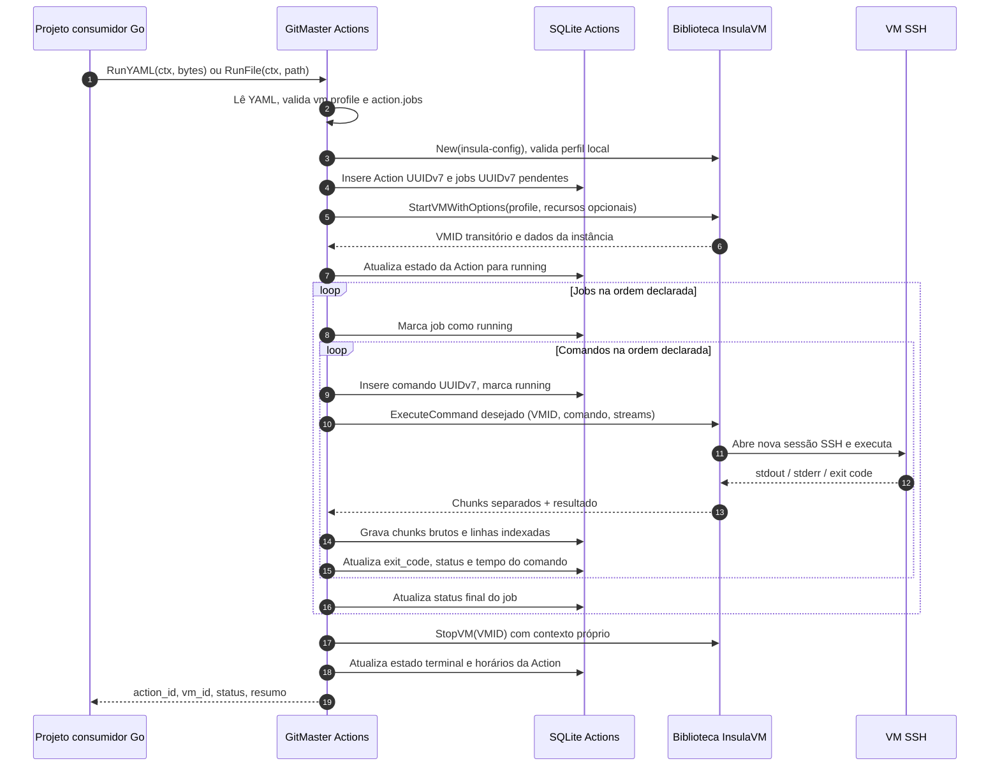

<!-- A-BIOMA-DOC-STANDARD -->
<!-- A-BIOMA-DOC-REVISADO -->

# FLUX-001 — Executar uma Action em VM isolada

**Estado:** fluxo base implementado em Go; sem teste KVM real nem recuperação automática de VMs após reinício.
**Versão de produção aprovada:** nenhuma (compilação e KVM pendentes).

## Objetivo

Receber YAML em memória ou o caminho do manifesto, registrar a execução com UUID, iniciar uma VM pelo InsulaVM e executar os comandos dos jobs, gravando os eventos de I/O no SQLite com vínculos rastreáveis.

## Entrada e pré-condições

- YAML válido (bytes ou arquivo local) segundo [CONTR-001](../contratos/CONTR-001-configuracao-action.md).
- Opções administrativas `InsulaConfigPath` e `DatabasePath` fornecidas ao inicializar `Engine`.
- Perfil QCOW2 já preparado e reconhecido no InsulaVM local; memória e vCPU, se omitidas, vêm do perfil.
- InsulaVM configurado e autorizado a operar Libvirt, Cloud-Init e SSH; espaço no disco para banco e imagens.
- Para separar `stdin/stdout/stderr` e capturar exit code fielmente, a implementação depende do contrato `ExecuteCommand` futuro do InsulaVM; `ExecVM` atual não supre esses campos.

## Diagrama de sequência

O diagrama exibe a **meta futura**. O GitMaster Actions ainda não implementa a execução; o transporte estruturado de STDIO/exit code depende de `ExecuteCommand` no InsulaVM.

## Processamento proposto

1. Validar `RunYAML` ou `RunFile`, `vm.profile` existente no InsulaVM local, `action.jobs` e caminhos administrativos. Memória/CPU ausentes não substituem os valores do perfil.
2. Gerar `action_id` UUIDv7 e persistir somente nome, estado e datas da Action (sem YAML, repositório ou dados da VM); criar um UUIDv7 para cada Job direto, na ordem definida, em transação.
3. Inicializar `insulavm.New`, validar o perfil existente e criar VM isolada local via `StartVMWithOptions`. Manter VMID apenas durante esta execução, sem persisti-lo em `actions`.
4. Executar importações opcionais **somente por operações públicas do InsulaVM**, respeitando `guest.destination` e validação dos arquivos.
5. Para cada job, processar os comandos em sequência. Antes de enviar comando, gerar `command_id` UUIDv7 e persistir seu texto. Cada comando é uma execução independente; não preservar estado de shell entre comandos.
6. Receber os bytes de stdin (se autorizado), stdout e stderr com escritores independentes; persistir chunks BLOB em `command_outputs` e linhas derivadas em `command_log_lines`. Persistir fragmentos finais sem LF no término do comando; não divulgar cursores antes de confirmar a gravação.
7. Registrar exit code remoto verdadeiro. Se não zero, marcar comando com falha e interromper os comandos seguintes e jobs posteriores quando `allow_failure=false`; com `allow_failure=true`, continuar desde que seja falha remota conhecida, não erro de infraestrutura.
8. Em cancelamento, falha de execução ou falha de armazenamento, registrar o que for possível, não declarar sucesso e tentar encerrar a VM. Marcar jobs/comandos que não começaram como `skipped` ou `cancelled`, conforme causa.
9. Sempre tentar `StopVM` explicitamente, usando contexto de limpeza independente do contexto cancelado. Registrar erro de limpeza na Action e **não** marcar sucesso completo se a política de limpeza obrigatória falhar.
10. Atualizar status terminal e `finished_at`, devolver objeto Action com UUID/estado e VMID transitório, quando disponível. Preservar o histórico no SQLite, sem recuperar VMs após perda do processo/servidor.

## Exceções e resultados

| Situação | Tratamento proposto |
| --- | --- |
| Configuração inválida | Rejeitar antes de provisionar; não inventar execução concluída |
| Perfil inexistente | Falha de validação sem criar VM |
| Origem diferente de perfil preparado | Rejeitar YAML inválido; somente `vm.profile` é suportado |
| Libvirt/Cloud-Init/SSH falha | Marcar Action `failed`, manter log parcial, tentar cleanup |
| Código remoto não zero | Persistir exit code e `remote_exit`; respeitar `allow_failure` |
| Cancelamento | Parar envio, preservar logs capturados, tentar `StopVM`, registrar `cancelled` se confirmado |
| Falha ao gravar SQLite | Não declarar sucesso; priorizar parada segura e emitir erro ao operador |
| Cleanup da VM falha | Retornar erro e, no processo corrente, expor VMID transitório para diagnóstico, sem gravá-lo no SQLite |

## Critérios de aceite futuros

- Nenhum comando é executado antes de o job, o comando e a Action terem seus respectivos IDs registrados.
- Logs de uma Action não se misturam aos de outra; VMID nunca é usado como substituto de `action_id`.
- A execução de comandos é sequencial por job, na ordem do manifesto.
- As saídas stdout/stderr são preservadas em bytes por canal, sem conversões, e exit code é distinto de erro de transporte.
- Falhas parciais e cancelamentos nunca são reportados como sucesso.
- A política de limpeza não remove VMs de outras Actions.
- Reinício ou queda do host não desencadeia retomada ou recuperação de VMs; estados `running` no SQLite podem estar obsoletos.

## Referências

- [CONTR-001 — Entrada](../contratos/CONTR-001-configuracao-action.md)
- [PERS-001 — Persistência](../persistencia/PERS-001-registro-execucoes.md)
- [ARQ-001 — Arquitetura](../arquitetura/ARQ-001-executor-actions.md)
- [InsulaVM: API Go existente](https://github.com/ahhvahh/InsulaVM/blob/main/docs/arquitetura/ARQ-004-biblioteca-go.md)

## Consultas após a execução

O consumidor usa `GetAction` e `ListActions` para localizar a execução e navega por `Action.Jobs(ctx)`, `Job.Commands(ctx)` e `Command.Logs(ctx, skipLines)` ou `Command.Outputs(ctx, filter, page)`; nenhuma consulta altera os dados. Ver [INTF-GO-001](../interfaces/go/INTF-GO-001-biblioteca-publica.md). A [CLI local de testes](../interfaces/terminal/INTF-TERM-001-cli-testes.md) utiliza essas mesmas operações, portanto não constitui um fluxo de execução diferente.