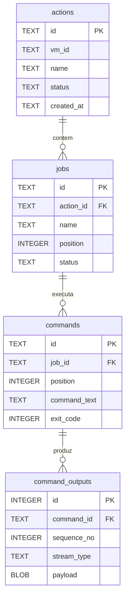

<!-- A-BIOMA-DOC-STANDARD -->
<!-- A-BIOMA-DOC-REVISADO -->

# PERS-001 — Registro de Actions, jobs, comandos e streams no SQLite

**Estado:** esquema proposto, **não** aplicado em banco. Este documento é a fonte canônica de entidades, tipos, relacionamentos, estados e índices para o GitMaster Actions.

## Objetivo

O GitMaster Actions é proprietário do SQLite: abre, cria/migra tabelas e escreve internamente. O projeto consumidor acessa os registros exclusivamente pela API de leitura [INTF-GO-001](../interfaces/go/INTF-GO-001-biblioteca-publica.md). `config_path` é nulo quando o YAML é recebido em memória; `config_sha256` é sempre calculado sobre o conteúdo recebido.

Persistir localmente a cadeia **Action → job (log do job) → comando → evento de STDIO**. O identificador da Action e o de cada job devem ser **UUIDv7 distintos**. Cada comando recebe UUIDv7 para correlação; cada chunk de stream recebe um inteiro autoincremental. O UUID da VM pertence ao InsulaVM e não substitui o UUID da Action.

## Modelo de relacionamento



`jobs` guarda o cabeçalho e o estado do **log de execução de cada job**. A tabela `commands` guarda cada comando enviado à VM, e `command_outputs` guarda os bytes lidos ou escritos. Não é necessária uma quinta tabela `logs` duplicando os dados do job.

## DDL proposto — SQLite

```sql
PRAGMA foreign_keys = ON;
PRAGMA journal_mode = WAL;
PRAGMA busy_timeout = 5000;

CREATE TABLE actions (
    id           TEXT PRIMARY KEY NOT NULL,
    name         TEXT NOT NULL,
    repository   TEXT NOT NULL,
    config_path  TEXT,
    config_sha256 TEXT NOT NULL,
    vm_source_type TEXT NOT NULL CHECK (vm_source_type IN ('profile','iso')),
    vm_source_value TEXT NOT NULL,
    vm_id        TEXT,
    status       TEXT NOT NULL CHECK (status IN
                 ('pending','starting','running','succeeded','failed','cancelled')),
    created_at   TEXT NOT NULL,
    started_at   TEXT,
    finished_at  TEXT,
    error_message TEXT
);

CREATE TABLE jobs (
    id            TEXT PRIMARY KEY NOT NULL,
    action_id     TEXT NOT NULL REFERENCES actions(id) ON DELETE RESTRICT,
    pipeline_name TEXT NOT NULL,
    name          TEXT NOT NULL,
    position      INTEGER NOT NULL CHECK (position >= 0),
    allow_failure INTEGER NOT NULL DEFAULT 0 CHECK (allow_failure IN (0,1)),
    status        TEXT NOT NULL CHECK (status IN
                  ('pending','running','succeeded','failed','skipped','cancelled')),
    started_at    TEXT,
    finished_at   TEXT,
    error_message TEXT,
    UNIQUE (action_id, position),
    UNIQUE (action_id, name)
);

CREATE TABLE commands (
    id            TEXT PRIMARY KEY NOT NULL,
    job_id        TEXT NOT NULL REFERENCES jobs(id) ON DELETE RESTRICT,
    position      INTEGER NOT NULL CHECK (position >= 0),
    command_text  TEXT NOT NULL,
    status        TEXT NOT NULL CHECK (status IN
                  ('pending','running','succeeded','failed','skipped','cancelled')),
    exit_code     INTEGER,
    failure_kind  TEXT CHECK (failure_kind IN ('remote_exit','infrastructure','storage','cancelled')),
    error_message TEXT,
    started_at    TEXT,
    finished_at   TEXT,
    UNIQUE (job_id, position)
);

CREATE TABLE command_outputs (
    id           INTEGER PRIMARY KEY AUTOINCREMENT,
    command_id   TEXT NOT NULL REFERENCES commands(id) ON DELETE RESTRICT,
    sequence_no  INTEGER NOT NULL CHECK (sequence_no >= 0),
    stream_type  TEXT NOT NULL CHECK (stream_type IN ('stdin','stdout','stderr')),
    payload      BLOB NOT NULL,
    captured_at  TEXT NOT NULL,
    UNIQUE (command_id, sequence_no)
);

CREATE INDEX idx_jobs_action_id ON jobs(action_id);
CREATE INDEX idx_commands_job_id ON commands(job_id);
CREATE INDEX idx_command_outputs_command_id ON command_outputs(command_id, sequence_no);
CREATE INDEX idx_actions_status_created ON actions(status, created_at);
```

A instrução `PRAGMA foreign_keys = ON` precisa ser aplicada **em cada conexão**. Datas são strings UTC RFC3339/RFC3339Nano geradas pelo aplicativo; IDs UUIDv7 usam representação textual canônica minúscula (36 caracteres). A aplicação deve validar UUIDs antes da persistência. O DDL acima é uma **proposta de migração**, não arquivo de migração já executado.

## Campos, cardinalidade e origem

| Tabela | Identificador | Vinculação | Conteúdo |
| --- | --- | --- | --- |
| `actions` | `id` UUIDv7 | Raiz | Origem perfil/ISO, nome, hash do arquivo recebido, VMID, estado e erro geral |
| `jobs` | `id` UUIDv7 | `action_id` | Uma linha por job/log; pipeline, nome, ordem, `allow_failure`, início/fim |
| `commands` | `id` UUIDv7 | `job_id` | Uma linha por comando; texto, posição, exit code, erro e estado |
| `command_outputs` | `id` INTEGER | `command_id` | Um registro por chunk recebido/enviado, tipo e bytes exatos |

O hash SHA-256 permite identificar o conteúdo exato do manifesto recebido; o caminho registra a origem, não substitui o hash. `vm_id` é nulo até a criação da VM; continua preenchido no histórico após o encerramento da VM.

## Eventos de I/O e integridade

- `stream_type='stdin'`: **dados enviados do executor para a VM**, não resposta produzida pela VM. Só gravar com `logging.capture_stdin=true` para entradas autorizadas; padrão seguro é não persistir stdin.
- `stream_type='stdout'`: bytes gerados pelo processo remoto em seu canal padrão.
- `stream_type='stderr'`: bytes gerados pelo processo remoto em seu canal de erro.
- `payload` é **BLOB**, não `TEXT`: preservar bytes NUL, UTF-8 incompleto, ausência de newline e conteúdo binário.
- `sequence_no` cresce por comando (0, 1, 2, ...), atribuído por um gravador que serializa os eventos de I/O. A sequência representa a **ordem de captura no host**; não garante a ordem causal entre stdout e stderr na VM.
- O gravador DEVE manter a ordem dos chunks **dentro de cada stream**. Separar escritores/leituras concorrentes e serializar os inserts para evitar colisão de sequência.
- Inserir comandos antes dos chunks; registrar `exit_code` apenas quando o remoto informou um código confiável. Um processo que terminou com código não zero (`failure_kind='remote_exit'`) não deve ser confundido com erro SSH (`failure_kind='infrastructure'`).
- Recomenda-se transação para criar a Action e seus jobs inicialmente; depois, gravar comandos e chunks incrementalmente para não perder todo o log ao ocorrer falha no meio da execução.
- Falha em persistir chunks deve impedir declaração de sucesso; tentar registrar erro de armazenamento e encerrar o processamento com falha. Se o banco estiver indisponível, relatar a impossibilidade de registrar o estado, **sem fabricar logs**.
- Não salvar credenciais, chaves SSH ou tokens em metadados. Os próprios comandos/streams podem expor segredos: definir acesso por UID/grupo, arquivo com permissão restrita, retenção e política de captura antes da produção.

## Estados

| Entidade | Estados | Regra |
| --- | --- | --- |
| Action | `pending → starting → running → succeeded/failed/cancelled` | Sucedida somente se não houver falha fatal, com cleanup tratado |
| Job | `pending → running → succeeded/failed/cancelled` ou `pending → skipped` | `allow_failure` tolera exit code remoto do job, mas registra o comando que falhou |
| Command | `pending → running → succeeded/failed/cancelled` ou `pending → skipped` | `exit_code` fica nulo se não foi recebido |

Em `allow_failure=true`, um comando pode estar `failed` e o job ser `succeeded` com falha tolerada; a informação detalhada permanece no histórico. Falha de infraestrutura nunca é tolerada implicitamente por `allow_failure`.

## Exemplos de consulta (referência, ainda não executados)

```sql
-- Listar jobs de uma Action por ordem
SELECT id, pipeline_name, name, status
FROM jobs WHERE action_id = ? ORDER BY position;

-- Reconstruir stdout de um comando, concatenando BLOBs na ordem
SELECT sequence_no, payload
FROM command_outputs
WHERE command_id = ? AND stream_type = 'stdout'
ORDER BY sequence_no;
```

A aplicação que consulta deve concatenar os BLOBs no cliente (não supor que `group_concat` preserve bytes binários). Para reconstruir STDIN ou STDERR, trocar o valor do filtro `stream_type`.

## Critérios de aceite futuros

- Uma Action produz UUIDv7 próprio e um VMID distinto quando criada VM.
- Cada job recebe UUIDv7 único e pertence exatamente a uma Action.
- Cada comando pertence exatamente a um job; cada chunk pertence exatamente a um comando.
- Constraints impedem referências órfãs; a aplicação ativa foreign keys em todas as conexões.
- Bytes de STDOUT/STDERR são reconstruídos exatamente e preservam ordem individual dos canais.
- O histórico não desaparece quando a VM é encerrada ou o processo termina.

## Referências

- [FLUX-001 — Sequência](../fluxos/FLUX-001-execucao-action.md)
- [CONTR-001 — Manifesto](../contratos/CONTR-001-configuracao-action.md)
- [InsulaVM: transporte STDIO futuro](https://github.com/ahhvahh/InsulaVM/blob/main/docs/interfaces/CONTR-002-transporte-stdio.md)