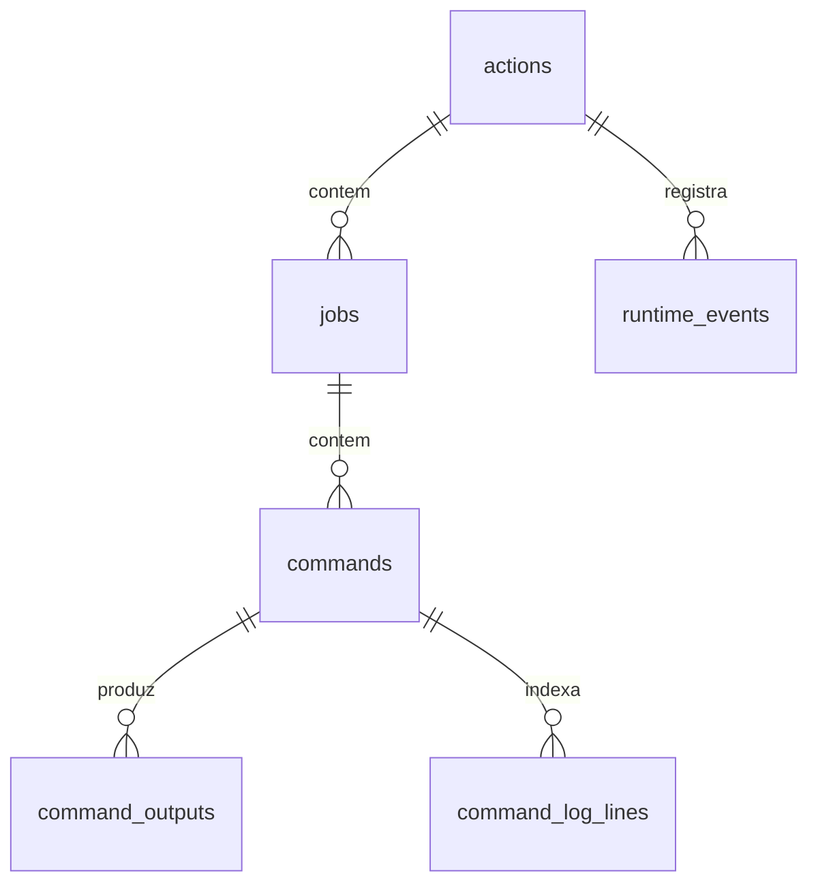

<!-- A-BIOMA-DOC-STANDARD -->
<!-- A-BIOMA-DOC-REVISADO -->

# PERS-001 — Banco SQLite exclusivo das Actions

**Estado:** esquema e migrações aditivas implementados em `store.go`, `service_store.go`, `legacy_import.go` e `legacy_normalize.go`. Nenhuma tabela do GitMaster é usada pelo novo `Engine`.

## Propriedade e integridade

`New(Options{DatabasePath})` administra `actions.db` e toma um lock advisory exclusivo em `<DatabasePath>.lock` (Linux). `Close` libera o lock, e um segundo Engine apontando ao mesmo banco não pode reclassificar os Jobs de um processo ativo. SQLite usa WAL, foreign keys, busy timeout e uma conexão serializada. O handle `*sql.DB` não é exposto pelo Engine.

## Entidades persistidas

| Tabela | Identificador | Dados |
| --- | --- | --- |
| `actions` | UUIDv7 | Nome, status, tempos, erro, clone/SHA/evento/branch, workflow, formato YAML, hashes de YAML e TAR.GZ, VM ID, cleanup e caminho temporário do material. |
| `jobs` | UUIDv7 | `action_id`, posição, nome, `needs_json`, motivo de skip, timeout, status e tempos. |
| `commands` | UUIDv7 | `job_id`, posição, nome/step, diretório, comando, exit code, falha, erro e tempos. |
| `command_outputs` | inteiro sequencial | `command_id`, `sequence_no`, `stream_type`, payload BLOB e captura. |
| `command_log_lines` | (`command_id`,`line_no`) | Projeção por linha para consulta incremental. |
| `runtime_events` | inteiro sequencial | `action_id`, stage, mensagem e instante. |
| `legacy_archive` | inteiro sequencial | Registro original completo e tipado das cinco tabelas legadas, preservando BLOBs em base64. |
| `legacy_links` | (`source`,`table_name`,`source_key`) | Mapeamento estável do ID antigo para a entidade normalizada no `actions.db`. |

## Idempotência e retenção

A identidade (`clone_id`,`commit_sha`,`workflow_path`,`event_type`) é única para eventos Git. Reenvio é autorizado **somente** quando o hash do YAML, hash do material, `event_id`, branch e formato coincidirem; conteúdo divergente é rejeitado. Registros anteriores sem hashes não são reutilizados como validação aprovada.

A Action, Jobs e Commands são gravados em transação antes da execução. O snapshot privado é removido ao concluir, preservando seu SHA256. Outputs persistidos mantêm o console *textual decorado* do InsulaVM, com redaction limitada; não prometer bytes nativos de stdout/stderr. Proteção, acesso e retenção de comandos e logs devem ser configurados pelo serviço consumidor.

## Migração e recuperação

`ImportLegacyHistory(ctx, pathAbsoluto)` abre o SQLite antigo em modo somente leitura. A operação é transacional no banco novo: preserva as cinco tabelas em `legacy_archive`, transforma Actions/Jobs/Commands, restaura logs e eventos para as tabelas próprias e mantém mapeamentos em `legacy_links`. Reimportações são idempotentes por fonte/tabela/ID original. Use `GetLegacyActionID(ctx, source, oldID)` e `GetActionDetails(ctx, id)` para consultar o grafo novo, ou `ListLegacyRecords` para auditoria exata.

O material histórico pode ter campos não representáveis no esquema atual: **a representação original permanece sempre no arquivo bruto**; outputs `system`/`error` são sinalizados com prefixos ao projetar em stdout/stderr. Não apagar o banco antigo antes de validar contagens, comandos e saída de cada migração. O pacote `legacy.NewStore(db, logs)` continua disponível somente para consumidores não migrados.

Na reabertura, Actions antigas `pending`/`starting`/`running` são marcadas `failed` e seus filhos pendentes são fechados. VM IDs pertencentes a essas Actions podem ser inspecionados e encerrados por `ReconcileInterrupted`, que não atua em Actions ainda em andamento. VMs históricas importadas não são encerradas sem prova de propriedade atual.

## Referências

[Interface Go](../interfaces/go/INTF-GO-001-biblioteca-publica.md) · [Arquitetura](../arquitetura/ARQ-001-executor-actions.md) · [Guia de migração](../guias/GUIA-008-integracao-gitmaster.md)